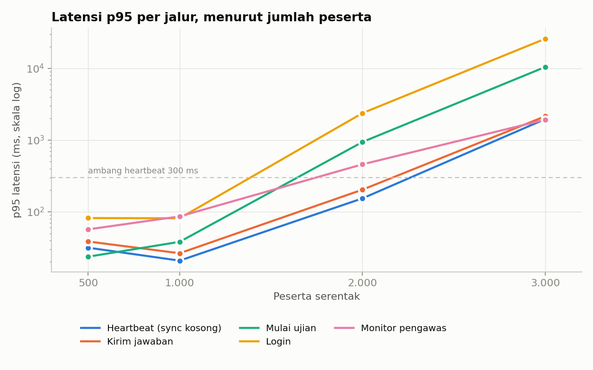
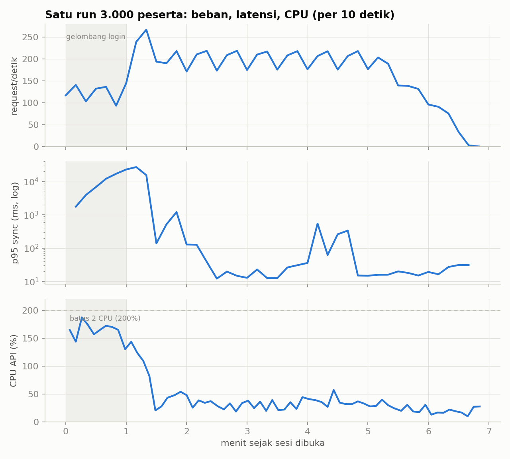
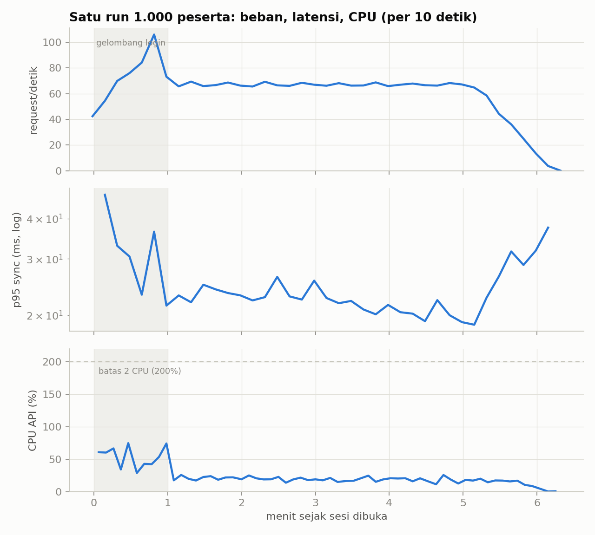
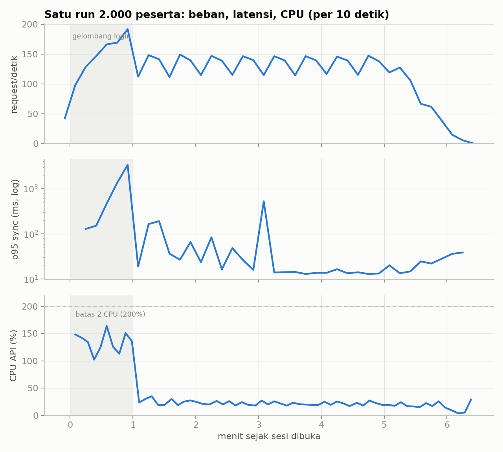
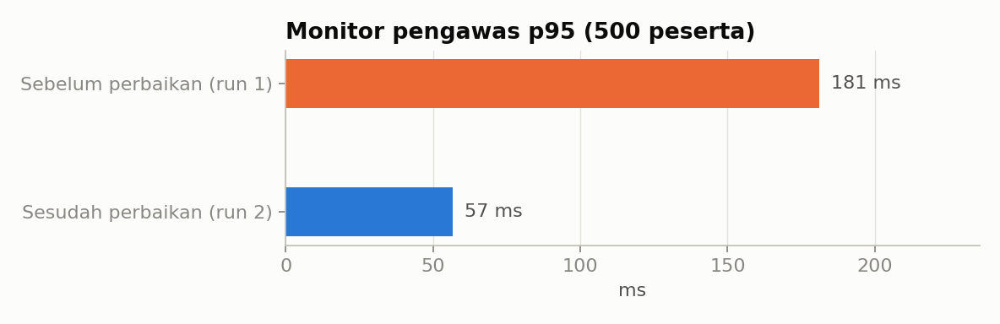
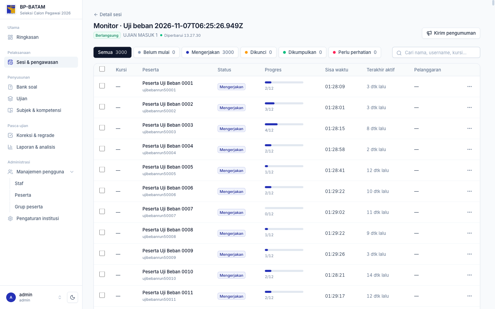
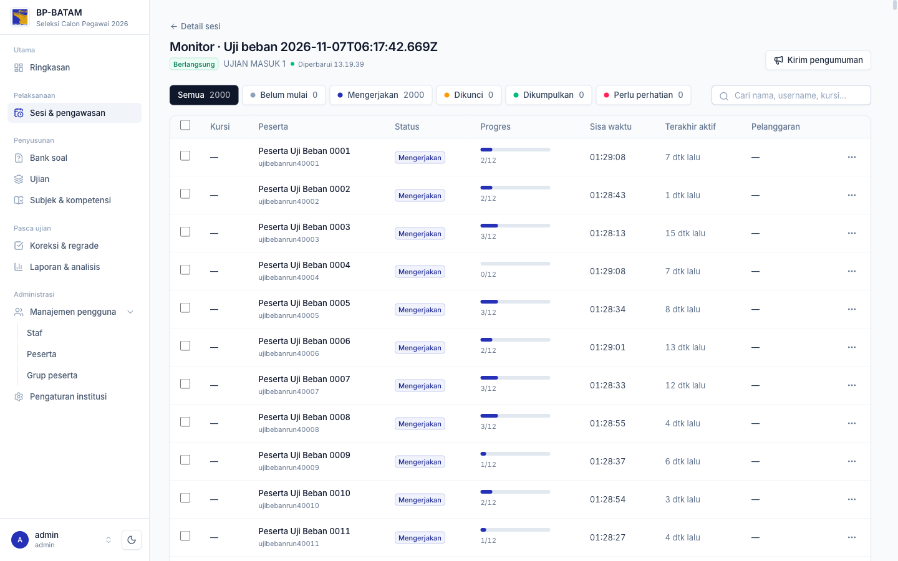
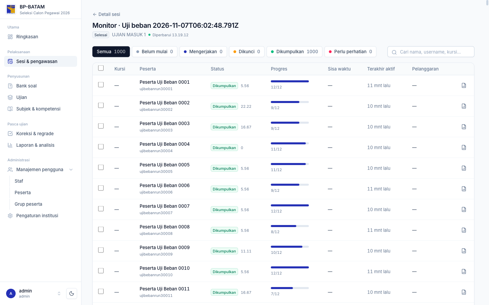

# Uji Beban DoExam

Hasil uji beban server DoExam: seberapa banyak peserta yang bisa mengerjakan ujian bersamaan, di mana batasnya, dan spesifikasi infrastruktur yang disarankan.

Alat uji dan cara mengulangnya ada di [`loadtest/README.md`](loadtest/README.md). Catatan perencanaan ada di `DOCS/PLAN/14-UJI-BEBAN.md` di repo utama.

## Ringkasan

| | |
|---|---|
| **Diuji sampai** | **3.000 peserta serentak**, API dibatasi **2 CPU** |
| **Data hilang** | **0**. Setiap jawaban yang diterima tersimpan di database, di semua run (sampai 29.090 jawaban dalam satu run). |
| **Request gagal** | **0%** di semua run (sampai 71.513 request dalam satu run) |
| **Kapasitas nyaman (2 CPU)** | **2.000 peserta** yang login dalam 1 menit. Semua ambang latensi terpenuhi. |
| **Batas yang ditemukan** | **Gelombang login.** Server 2 CPU memproses ±35 login per detik, karena tiap login menjalankan hash password Argon2. Pada 3.000 peserta yang login dalam 1 menit, login p95 menjadi 26 detik. |
| **Saat ujian berjalan** | Setelah semua peserta masuk, **3.000 peserta** dilayani dengan sync p95 **60 ms** dan CPU API median **34% dari 200%**. |

Artinya, jumlah peserta tidak dibatasi oleh berjalannya ujian. Yang membatasi adalah **berapa banyak peserta yang login bersamaan**. Dengan 2 CPU, 3.000 peserta tertangani dengan baik bila loginnya tersebar sekitar 90 detik atau lebih, misalnya lewat jadwal sesi bertahap per ruang.

## Spesifikasi uji

| | |
|---|---|
| Mesin | Apple M1, 8 core, RAM 8 GB, macOS 27. **Semua komponen di satu mesin**, lewat loopback (tanpa latensi jaringan). |
| API | Binary `doexam` (Go 1.27), `GOMAXPROCS=2` untuk meniru 2 vCPU, `APP_ENV=staging` (query di atas 200 ms dicatat di log). Pool DB 25 koneksi. |
| Cache | Redis 7.4 untuk konten soal dan rencana ujian. Cache login (auth) di memori, `AUTH_CACHE_TTL=30s`. |
| Database | PostgreSQL 16.15 di Docker (OrbStack, VM 8 CPU / 4 GB). **Tidak dibatasi CPU.** |
| Generator beban | k6 v0.53, di mesin yang sama |
| Ujian | 12 soal acak dari pool campuran: PG tunggal, PG kompleks, benar/salah, isian, esai. Satu section berdurasi (mode berurutan). |
| Skenario | Peserta datang tersebar dalam **60 detik**, login, lalu memulai ujian. Selama 5 menit tiap peserta mengirim sync tiap ±15 detik; separuhnya membawa satu jawaban. **2 pengawas** membuka monitor tiap 5 detik. Sesi ditutup di akhir, dan semua attempt dikumpulkan. |
| Ambang lulus | request gagal < 1% · 0 event ditolak · heartbeat p95 < 300 ms · kirim jawaban p95 < 500 ms · mulai ujian p95 < 2 detik |

## Hasil

| Peserta | 500 (sebelum perbaikan monitor) | 500 | 1.000 | 2.000 | 3.000 |
|---|---|---|---|---|---|
| Hasil | ✅ lulus | ✅ lulus | ✅ lulus | ✅ lulus | ⚠️ ambang latensi terlewati saat login |
| Request (rata-rata/detik) | 12.375 (32) | 12.361 (32) | 24.602 (62) | 48.852 (115) | 71.513 (152) |
| Gagal · event ditolak | 0% · 0 | 0% · 0 | 0% · 0 | 0% · 0 | 0% · 0 |
| Jawaban diterima → tersimpan | 5.001 → 5.001 | 4.980 → 4.980 | 9.936 → 9.936 | 19.765 → 19.765 | 29.090 → 29.090 |
| Login p95 | 83 ms | 82 ms | 81 ms | 2,4 s | **25,9 s** |
| Mulai ujian p95 | 38 ms | 24 ms | 38 ms | 940 ms | **10,5 s** |
| Heartbeat p95 | 39 ms | 32 ms | 21 ms | 154 ms | **2,0 s** |
| Kirim jawaban p95 | 46 ms | 38 ms | 26 ms | 203 ms | **2,1 s** |
| Monitor pengawas p95 | 181 ms | 57 ms | 86 ms | 458 ms | 1,9 s |
| Memori API maks | 229 MB | 219 MB | 253 MB | 266 MB | 385 MB |



*Skala log. Garis putus-putus adalah ambang heartbeat (300 ms). Sampai 1.000 peserta semua jalur di bawah 100 ms. Pada 2.000 peserta, login dan mulai ujian naik, tapi masih di bawah ambang. Pada 3.000 peserta, antrean login merembet ke jalur lain.*

### Gelombang login vs fase ujian

Angka p95 di tabel atas mencakup seluruh run, termasuk menit pertama saat semua peserta login. Bila dipisah, terlihat bahwa beban ujian itu sendiri ringan:

| Peserta | Lama gelombang login | Sync p50 · p95 · p99 saat ujian | Monitor p95 saat ujian | CPU API saat ujian (median · maks, dari 200%) |
|---|---|---|---|---|
| 1.000 | 59 s | 11 · 22 · 31 ms | 87 ms | 19% · 26% |
| 2.000 | 62 s | 8 · 17 · 99 ms | 204 ms | 21% · 27% |
| 3.000 | 85 s | 7 · 60 · 316 ms | 300 ms | 34% · 57% |

*Fase ujian = mulai menit ke-2 setelah sesi dibuka sampai 90 detik sebelum peserta selesai. Diambil dari log request API.*



*Run 3.000 peserta. Selama gelombang login (area abu-abu) CPU API hampir penuh (±185%), sehingga login dan request lain mengantre sampai puluhan detik. Begitu semua peserta masuk, sekitar menit ke-1,5, CPU turun ke 30–50% dan sync kembali ke belasan milidetik. Ada satu lonjakan singkat di menit ke-4,2 (lihat [Temuan terbuka](#temuan-terbuka)).*

<details>
<summary>Timeline run 1.000 dan 2.000 peserta</summary>





</details>

### Perbaikan yang lahir dari uji ini

Run pertama menemukan bahwa monitor pengawas **mengunci semua attempt** di sesinya setiap kali di-refresh. Selama monitor berjalan, sync semua peserta ikut menunggu.

Monitor sekarang hanya mengunci attempt yang memang sudah lewat waktu (`FOR UPDATE SKIP LOCKED`). Detailnya ada di PR #18 server.



| | Sebelum (run 1) | Sesudah (run 2) |
|---|---|---|
| Monitor p95 · 500 peserta | 181 ms | 57 ms |
| Query yang menunggu lock attempt | 8 | 0 |

## Bukti

Screenshot halaman **Monitor** di panel DoExam, diambil saat uji berlangsung, dari data sungguhan.

**3.000 peserta sedang mengerjakan** (sesi berlangsung; terakhir aktif 2–14 detik lalu; sisa waktu ±1 jam 28 menit):



**2.000 peserta sedang mengerjakan:**



**1.000 peserta selesai** (semua attempt dikumpulkan dan dinilai otomatis):



**Tidak ada jawaban yang hilang.** Jumlah jawaban yang diterima server (`lt_answers_accepted` di k6) dibandingkan dengan isi database untuk setiap sesi uji:

```sql
SELECT count(*) FILTER (WHERE ai.response IS NOT NULL), count(DISTINCT a.id)
FROM attempts a JOIN attempt_items ai ON ai.attempt_id = a.id
WHERE a.session_id = '<sesi uji>';
-- 2.000 peserta: 19765 | 2000
-- 3.000 peserta: 29090 | 3000
```

Cuplikan ringkasan k6, run 3.000 peserta:

```text
     ✓ login 200 · ✓ start 200 · ✓ sync 200 · ✓ monitor 200
     checks.........................: 100.00% ✓ 65507      ✗ 0
   ✓ http_req_failed................: 0.00%   ✓ 0          ✗ 71513
     lt_answers_accepted............: 29090
     lt_answers_sent................: 29090
   ✓ lt_events_rejected.............: 0
     lt_login.......................: med=6.05s    p(95)=25.91s
   ✗ lt_start.......................: med=1.3s     p(95)=10.46s
   ✗ lt_sync_answer.................: med=10.07ms  p(95)=2.14s
   ✗ lt_sync_heartbeat..............: med=6.85ms   p(95)=1.96s
```

## Opsi spesifikasi infrastruktur

DoExam terdiri atas tiga bagian:
- **BE**: binary `doexam` (Go)
- **FE**: file statis exam client dan panel, disajikan nginx atau CDN, tanpa Node saat produksi
- **DB**: PostgreSQL

Redis opsional; berguna bila API lebih dari satu node.

Opsi A dan B **didukung langsung oleh hasil uji** di atas. Opsi C dan D adalah **ekstrapolasi** dan perlu diuji sebelum dipakai.

| | **A. Sekolah / lab kecil** | **B. Sekolah besar / kampus** | **C. Ujian massal** | **D. Skala nasional** |
|---|---|---|---|---|
| Peserta serentak | ≤ 1.000 | ≤ 3.000 | ≤ 10.000 | > 10.000 |
| Topologi | 1 server, semua di dalamnya | 1 server (atau BE dan DB dipisah) | BE 2+ node di belakang load balancer | BE banyak node, DB terkelola |
| **BE** | 2 vCPU · 2 GB | 4 vCPU · 4 GB | 2–3 × (4 vCPU · 4 GB) | 4+ × (8 vCPU · 8 GB) |
| **FE** | nginx di server yang sama | nginx di server yang sama | nginx terpisah 1 vCPU · 1 GB, atau CDN | CDN |
| **DB** | di server yang sama, 2 GB RAM untuk PostgreSQL | 2 vCPU · 4 GB (bila dipisah) | 4 vCPU · 16 GB, SSD NVMe | 8+ vCPU · 32 GB, replika baca, PgBouncer |
| Redis | tidak perlu | opsional | 1 GB (cache konten bersama) | 2–4 GB |
| Total satu server | **2 vCPU · 4 GB · SSD 40 GB** | **4 vCPU · 8 GB · SSD 80 GB** | — | — |
| Jaringan | LAN 100 Mbps | LAN 1 Gbps / uplink ≥ 100 Mbps | ≥ 1 Gbps | CDN + ≥ 1 Gbps |
| Dasar | Terukur: 2 CPU melayani 1.000–2.000 peserta dengan nyaman | Terukur: 2 CPU melayani 3.000 peserta saat ujian. Butuh 4 vCPU agar gelombang login 1 menit tidak mengantre. | Ekstrapolasi, perlu diuji | Ekstrapolasi, perlu diuji |

Dasar perhitungannya:
- **CPU BE ditentukan oleh gelombang login, bukan oleh ujiannya.** Kapasitas login sekitar **17–18 login per detik per vCPU** (±35 per detik pada 2 CPU). Rumusnya: `vCPU ≈ peserta ÷ lama gelombang login (detik) ÷ 17`, ditambah cadangan 30–50%. Contoh: 3.000 peserta login dalam 60 detik membutuhkan sekitar 3 vCPU, jadi pakai 4.
  - Cara lain tanpa menambah CPU: buka sesi bertahap per ruang, atau beri jeda login beberapa menit sebelum ujian dimulai.
- **Memori BE:** puncak 385 MB pada 3.000 peserta, sebagian besar dari buffer Argon2 saat login. 2 GB memberi cadangan yang lega.
- **DB:** CPU PostgreSQL maksimal ±1 core pada 3.000 peserta. Data tumbuh ±10 KB per attempt pada uji ini (12 soal, 5 menit); untuk ujian 90 menit dengan ±40 soal, perkirakan **50–100 KB per attempt**, atau sekitar 50–100 MB per 1.000 peserta, belum termasuk WAL dan backup.
- **FE:** pemuatan pertama exam client sekitar **250 KB per peserta** (JS awal 126 KB gzip, ditambah CSS, font, dan HTML), belum termasuk gambar dan audio soal. 3.000 peserta yang membuka dalam 1–2 menit membutuhkan sekitar 750 MB, atau ±60–100 Mbps. Setelah termuat, exam client bekerja offline-first, sehingga traffic saat ujian hanya sync kecil.

## Temuan terbuka

- **Lonjakan latensi singkat, sekitar 1 detik, sekali per run.** Polanya: semua request yang sedang berjalan tertahan bersamaan, atau dua poll monitor yang bersamaan menjadi lambat. Saat itu CPU sedang rendah, dan penyebabnya bukan lock attempt.
  - Dugaan: gangguan dari VM Docker di macOS, atau autovacuum/autoanalyze pada tabel attempt yang sangat aktif.
  - Untuk diperiksa di VM sungguhan: `log_autovacuum_min_duration = 0`, `pg_stat_statements`, dan trace runtime Go.
- **Biaya login (Argon2)** adalah batas pertama. Opsinya: tambah CPU, sebar waktu login, atau tinjau parameter Argon2. Parameter Argon2 menyangkut keamanan, jadi perlu keputusan tersendiri.

## Batasan uji ini

- Semua komponen berjalan di **satu mesin**, PostgreSQL **tidak dibatasi CPU**, dan **tidak ada latensi jaringan**. Server sungguhan dengan 2 vCPU yang dipakai bersama oleh API dan database akan lebih lambat. Ulangi uji di VM yang sesuai opsi di atas sebelum memakai angkanya untuk pengadaan.
- Durasi ujian 5 menit, bukan 90 menit. Pertumbuhan tabel dan cache selama ujian penuh belum teruji.
- Peserta virtual hanya mengirim heartbeat dan jawaban. Exam client sungguhan juga memuat media dan mengirim event lain (soal dilihat, ragu-ragu, pelanggaran).
- k6 berjalan di mesin yang sama dengan server dan ikut memakai CPU.
