# Monitoring DoExam API: Prometheus + Grafana

Panduan memasang Prometheus dan Grafana (Docker), plus laporan uji beban k6 500 peserta yang dipantau lewat dashboard **DoExam API**. Katalog metrik ada di [METRICS.md](METRICS.md); rencananya di `DOCS/PLAN/16-MONITORING-METRIK.md` (repo utama).

## 1. Memasang

Prometheus dan Grafana adalah service `prometheus` dan `grafana` di [`docker-compose.yml`](docker-compose.yml). Konfigurasinya ada di [`monitoring/`](monitoring/):

| File | Isi |
|------|-----|
| `monitoring/prometheus/prometheus.yml` | Scrape `/metrics` API tiap 5 detik, dengan token Bearer |
| `monitoring/prometheus/alerts.yml` | 11 aturan alert (API/dependency mati, 5xx, event ditolak, sync lambat, pool DB antre, peserta stale, login gagal, disk, memori, panic) |
| `monitoring/grafana/provisioning/` | Datasource Prometheus + pemuat dashboard (otomatis saat container start) |
| `monitoring/grafana/dashboards/doexam-api.json` | Dashboard **DoExam API** (40 panel) |
| `monitoring/.metrics-token` | Token scrape (dibuat sendiri, tidak masuk git) |

```bash
openssl rand -hex 16 > monitoring/.metrics-token      # sekali
docker compose up -d prometheus grafana
```

API harus membuka `/metrics` di port 9464 dengan token yang sama:

- **Binary/`go run` di host:**
  ```bash
  METRICS_ADDR=0.0.0.0:9464 METRICS_TOKEN=$(cat monitoring/.metrics-token) make run/api
  ```
- **Service `api` di compose:** sudah memakai `METRICS_ADDR=0.0.0.0:9464` dan mem-publish port ke `127.0.0.1:9464`. Isi `METRICS_TOKEN` di `.env` dengan isi `monitoring/.metrics-token`.

Prometheus menjangkau keduanya lewat `host.docker.internal:9464`.

| Alamat | Untuk |
|--------|-------|
| http://localhost:3000 | Grafana: dashboard **DoExam API** langsung jadi beranda. Penonton tanpa login boleh melihat; login admin `admin` / `GRAFANA_ADMIN_PASSWORD` (bawaan `admin`) |
| http://localhost:9090 | Prometheus: status target (`/targets`) dan alert (`/alerts`) |

Semua port monitoring hanya di-*bind* ke `127.0.0.1`. Di server sungguhan, ganti password admin Grafana dan jangan buka port 9090/9464 ke internet.

## 2. Dashboard

Enam baris, urut dari yang paling penting saat hari ujian:

1. **Ujian live**: peserta terhubung/stale, sync p95, event ditolak, jawaban tersimpan, 5xx; tren mulai attempt per hasil, event sync per hasil, latensi jalur peserta, lag klien → server, penolakan & pelanggaran.
2. **API**: request per route, per kelas status, request yang sedang diproses, p95 per route, ukuran body sync, login per hasil.
3. **Auth & Argon2**: durasi dan antre Argon2, hit ratio cache (token, konten soal, rencana ujian), rate limit & panic.
4. **Database**: pool koneksi, request menunggu koneksi, transaksi tenant p95 per method service, query p95 per tabel, query per operasi, query lambat & error.
5. **PostgreSQL**: sesi menunggu lock, koneksi aktif, transaksi per detik, dead tuples tabel ujian.
6. **Proses & runtime Go**: CPU, RSS, goroutine, jeda scheduler & GC.

Warna mengikuti satu palet kategori yang urutannya tetap; warna status (hijau/kuning/oranye/merah) hanya untuk keadaan (2xx/4xx/5xx, ditolak, stale), tidak untuk seri biasa. Panel yang serinya dinamis (per route, per tabel) memakai warna per nama, jadi satu route berwarna sama di semua panel.

## 3. Uji beban 2026-11-07

### Kondisi

| Hal | Nilai |
|-----|-------|
| API | Binary `doexam` di host, `GOMAXPROCS=2`, `APP_ENV=staging`, Redis untuk cache konten, `AUTH_CACHE_TTL=30s` |
| Database | PostgreSQL 16 (container `doexam-dev-pg`), tanpa batas CPU |
| Monitoring | Prometheus v3.5 + Grafana 12.1 di Docker Desktop (VM 8 CPU / 4 GB, dipakai bersama PostgreSQL dan Redis) |
| Mesin | Satu Mac (Apple Silicon, 8 CPU). k6, API, dan semua container di mesin yang sama |
| Skenario | [`loadtest/exam.js`](loadtest/exam.js): 500 peserta login tersebar 60 detik, mulai attempt, 5 menit mengerjakan (sync tiap ±15 detik, separuhnya membawa jawaban), 2 proktor membuka monitor tiap 5 detik, sesi ditutup di akhir |

Satu instance DoExam lain (port 8080) juga terhubung ke database yang sama selama uji; koneksinya ikut terhitung di panel PostgreSQL.

Uji 500 peserta dijalankan tiga kali, lalu satu kali dengan 1.000 peserta (§3.4). **Run 1** dihentikan saat Prometheus/Grafana dipindah ke `docker-compose.yml` server. **Run 2** menemukan bug metrik (§3.3). **Run 3** memakai binary yang sudah diperbaiki dan menjadi hasil utama di bawah.

### 3.1 Hasil run 3 (utama)

| Metrik | Hasil | Ambang |
|--------|-------|--------|
| Request | 12.382 (±32/detik), **0% gagal**, 11.375 check lulus | < 1% |
| Event ditolak | **0** | 0 |
| Jawaban terkirim → diterima → tersimpan di DB | **4.972 → 4.972 → 4.972** (500 attempt) | sama |
| Login p95 / maks | 100 ms / 718 ms | — |
| Mulai attempt p95 / maks | 49 ms / 158 ms | p95 < 2 s |
| Sync heartbeat p95 / maks | 30 ms / 248 ms | p95 < 300 ms |
| Sync berisi jawaban p95 / maks | 36 ms / 279 ms | p95 < 500 ms |
| Monitor proktor p95 / maks | 98 ms / 203 ms | — |

Angka di atas dari ringkasan k6. Dari Prometheus, selama fase ujian (median / p90 / maks):

| Metrik | Nilai |
|--------|-------|
| Peserta terhubung | 500 / 500 / 500 |
| Sync p95 (`http_server_request_duration_seconds`) | 42 / 47 / 52 ms |
| Sync p99 | 59 / 155 / 199 ms |
| Transaksi `AttemptService.Sync` p95 | 25 / 34 / 44 ms |
| CPU API (dari 2 core) | 0,12 / 0,15 / 0,37 core |
| Memori RSS | 54 / 58 / 139 MB (puncak saat membuat 500 akun) |
| Goroutine | ±520 (satu per koneksi keep-alive peserta) |
| Koneksi DB dipakai (pool 25) | 0 / 1 / 7, **tanpa antre** |
| Query DB | ±276 query/detik untuk ±34 request/detik (±8 query per request) |
| Hit ratio cache token | ±60% |

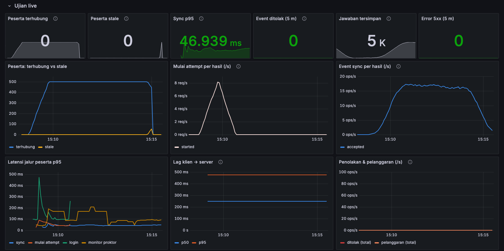

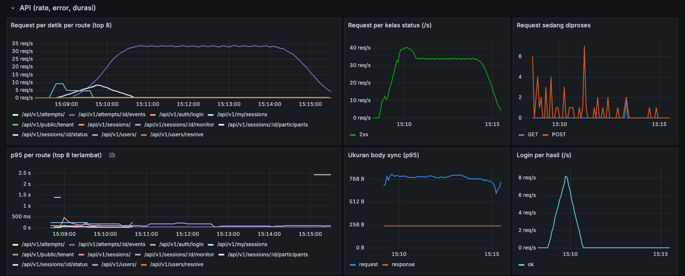

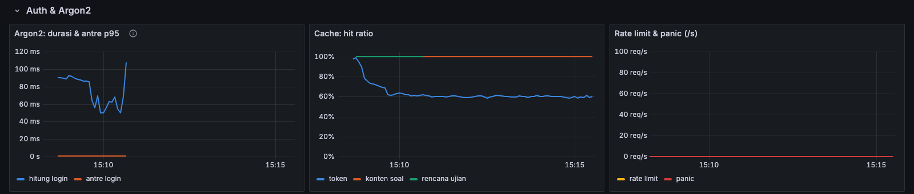

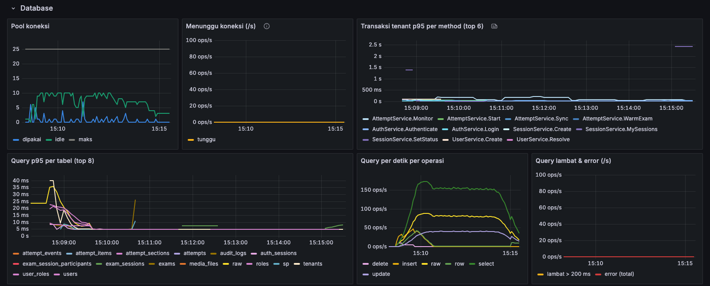

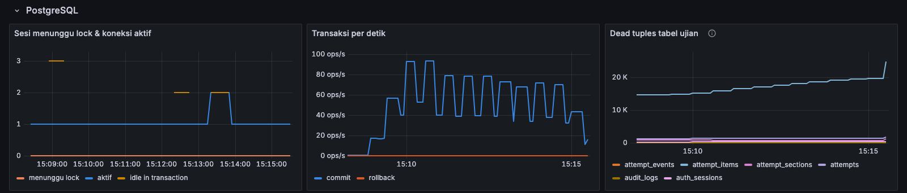

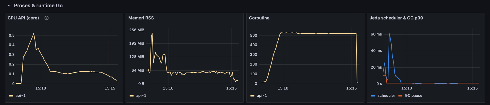

Dashboard utuh: [monitoring/img/dashboard-full.png](monitoring/img/dashboard-full.png).

### 3.2 Membaca grafiknya

- **Peserta terhubung** naik ke 500 selama gelombang login, datar selama ujian, lalu turun saat sesi ditutup. Lonjakan kecil **stale** di akhir adalah peserta yang berhenti sync sesaat sebelum sesi ditutup: sesuai skenario.
- **Mulai attempt per hasil** hanya berisi `started`: tidak ada token salah, perangkat terkunci, atau konflik.
- **Event sync per hasil** hanya berisi `accepted` (±17 event/detik): tidak ada duplikat maupun penolakan.
- **Argon2** hanya aktif saat gelombang login (p95 50–110 ms) dan **tidak pernah antre**: slot Argon2 cukup untuk 500 login dalam 60 detik di 2 core.
- **Transaksi `SessionService.SetStatus` ±2,4 detik** di akhir adalah penutupan sesi: 500 attempt di-submit dan dinilai dalam satu transaksi. Ini wajar untuk aksi sekali jalan, tetapi akan bertambah lurus dengan ukuran sesi.

### 3.3 Temuan

1. **Bug metrik: angka peserta menggelembung (diperbaiki).** Di run 2 panel *Peserta terhubung* mencapai ±1.900 dan *stale* 8.300, padahal pesertanya 500. Penyebabnya: `id` attempt dari `c.Params()` Fiber menunjuk ke buffer request yang dipakai ulang request berikutnya, lalu disimpan sebagai key map. Key-nya ikut berubah isi, sehingga satu attempt tercatat berkali-kali. Perbaikan: key disalin (`strings.Clone`) sebelum disimpan, dengan test regresi yang gagal tanpa perbaikan (`TestPresenceCopiesID`). Run 3 menunjukkan angka yang benar (500). Ini bug yang sama jenisnya dengan label method `GETT` yang ditemukan saat implementasi metrik.

   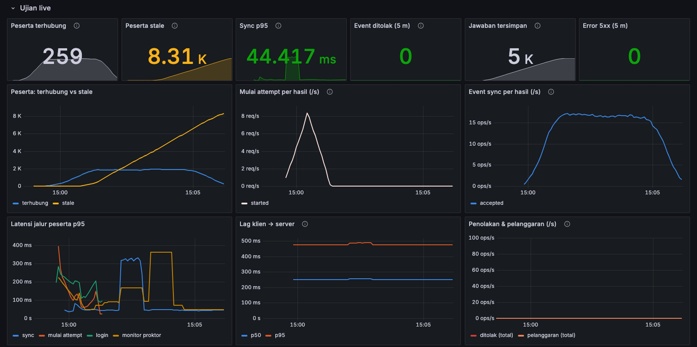

2. **Jeda database ±2 detik di run 2 (tidak terulang di run 3).** Pukul 15:01:59–15:02:01 sync p99 naik ke 1,8 detik dan maksimum sync 2 detik. Metrik baru melokalisasi penyebabnya:
   - query primary key ke tabel `tenants` (beberapa baris saja) butuh sampai **711 ms**; 47 query lambat tercatat dalam 3 detik, semuanya query sederhana (`tenants`, `set_config`, `attempts`);
   - pool koneksi penuh sesaat (24 dari 25) dan request mulai antre, **akibat** query yang tertahan, bukan penyebabnya;
   - CPU API rendah (0,1–0,2 core), jeda scheduler Go dan GC normal, tidak ada sesi yang menunggu lock;
   - PostgreSQL sedang menjalankan checkpoint yang disebar (15:00:15–15:04:30, sync file hanya 0,044 detik).

   Jadi yang tersendat adalah PostgreSQL atau VM Docker-nya, bukan API. Polanya sama dengan "jeda yang belum terjelaskan" pada run 2 dan 3 di `DOCS/PLAN/14-UJI-BEBAN.md` (repo utama), yang waktu itu hanya bisa dilacak lewat log; kini metrik menunjukkan bahwa API tidak sedang sibuk dan Go runtime tidak berhenti. Karena VM Docker di macOS juga menjalankan Prometheus, Grafana, Redis, dan container lain, penyebab paling mungkin adalah gangguan I/O atau CPU di VM. Perlu dipastikan di VM Linux sungguhan.

   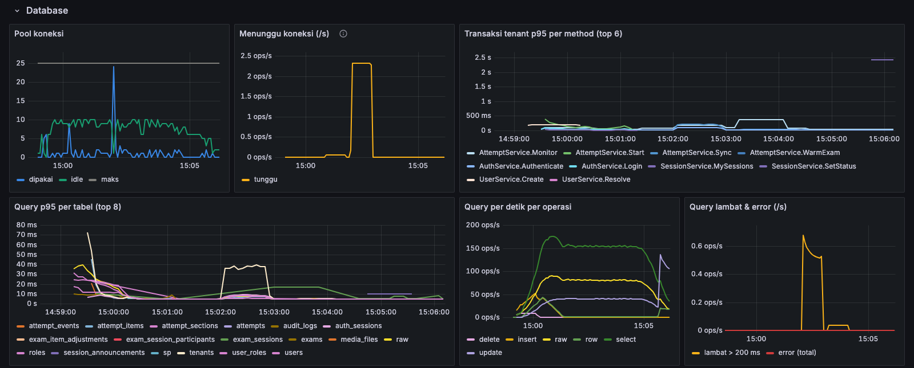

3. **Hit ratio cache token hanya ±60%.** Peserta mengirim heartbeat tiap ±15 detik, sementara `AUTH_CACHE_TTL=30s`, sehingga kira-kira satu dari dua atau tiga validasi token tetap membaca database. Menaikkan TTL ke 60–120 detik akan memangkas sepertiga sampai setengah dari query autentikasi, dengan risiko pencabutan akses di node lain berlaku lebih lambat (lihat `AUTH_CACHE_TTL` di README).

4. **Dead tuples `attempt_items` terus naik selama ujian** (±15.000 → ±19.600 dalam 6 menit). Setiap jawaban meng-UPDATE baris `attempt_items`; autovacuum belum sempat membersihkannya. Untuk ujian 90 menit yang lebih besar, pertimbangkan `autovacuum_vacuum_scale_factor` yang lebih kecil khusus tabel ini. Panel *Dead tuples tabel ujian* adalah tempat memantaunya.

5. **Lag klien → server** tercatat di bucket pertama histogram (< 500 ms) sepanjang uji, karena k6 mengirim event segera. Bucket histogram kini ditambah 50/100/250 ms supaya lag sub-detik bisa dibaca (berlaku mulai build berikutnya; grafik di laporan ini masih memakai bucket lama).

### 3.4 1.000 peserta serentak (run 4)

Kondisi sama dengan run 3, binary yang sama (sudah berisi perbaikan §3.3 dan bucket lag baru), dengan **1.000 peserta** yang login tersebar dalam 60 detik.

| Metrik (k6) | 500 peserta (run 3) | **1.000 peserta (run 4)** | Ambang |
|-------------|---------------------|---------------------------|--------|
| Request (rata-rata/detik) | 12.382 (32) | **24.603 (62)** | — |
| Gagal · event ditolak | 0% · 0 | **0% · 0** | < 1% · 0 |
| Jawaban terkirim → diterima → tersimpan di DB | 4.972 → 4.972 → 4.972 | **9.836 → 9.836 → 9.836** | sama |
| Attempt dibuat → di-submit saat sesi ditutup | 500 → 500 | **1.000 → 1.000** | sama |
| Login p95 / maks | 100 / 718 ms | **86 / 166 ms** | — |
| Mulai attempt p95 / maks | 49 / 158 ms | **43 / 140 ms** | p95 < 2 s |
| Sync heartbeat p95 / maks | 30 / 248 ms | **21 / 169 ms** | p95 < 300 ms |
| Sync berisi jawaban p95 / maks | 36 / 279 ms | **27 / 228 ms** | p95 < 500 ms |
| Monitor proktor p95 / maks | 98 / 203 ms | **66 / 75 ms** | — |

Dari Prometheus, fase ujian (median / p90 / maks):

| Metrik | 500 peserta | **1.000 peserta** |
|--------|-------------|-------------------|
| Peserta terhubung | 500 | **1.000** (stabil) |
| Request/detik | 34 | **67** |
| Sync p95 · p99 | 42 · 59 ms | **24 · 44 ms** |
| Transaksi `AttemptService.Sync` p95 | 25 ms | **23 ms** |
| Lag klien → server p50 · p95 | < 500 ms (bucket lama) | **25 · 48 ms** |
| CPU API (dari 2 core) | 0,12 core | **0,21 core** (puncak 1,07 saat membuat 1.000 akun dan gelombang login) |
| Memori RSS | 54 MB | **83 MB** (maks 89 MB selama ujian) |
| Goroutine | ±520 | **±1.020** |
| Query DB/detik | ±276 | **±546** |
| Koneksi DB dipakai (pool 25) | maks 7 | **maks 7**, 0 antre, 0 query lambat |
| Antre Argon2 p95 | 0 | **≤ 1 ms** |
| Hit ratio cache token | ±60% | **±60%** |
| Transaksi tutup sesi (`SessionService.SetStatus`) | 2,4 s | **4,9 s** |

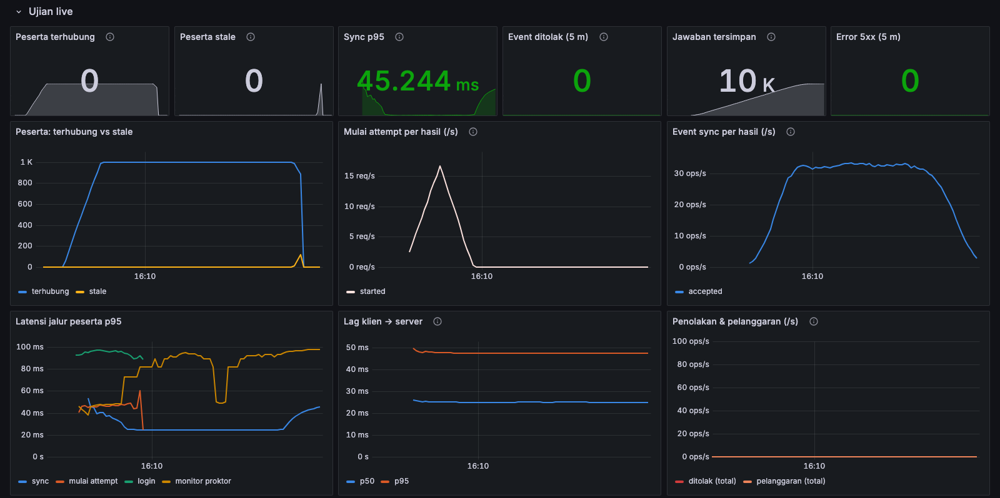

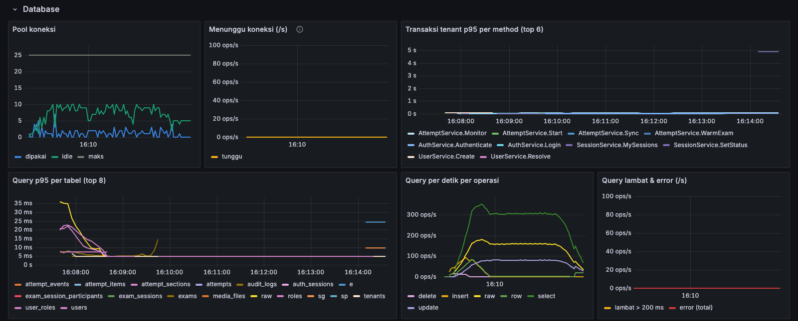

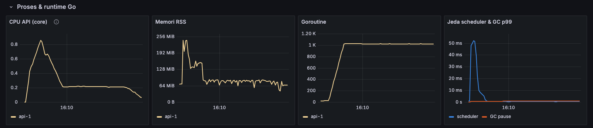

Bagian lain: [API](monitoring/img/1000-02-api-rate-error-durasi.png) · [Auth & Argon2](monitoring/img/1000-03-auth-argon2.png) · [PostgreSQL](monitoring/img/1000-05-postgresql.png) · [dashboard utuh](monitoring/img/1000-dashboard-full.png).

**Kesimpulan:**

- **1.000 peserta lulus semua ambang** dengan sisa kapasitas besar: selama ujian API memakai ±11% dari 2 core, pool DB tidak pernah lebih dari 7 koneksi, dan tidak ada query di atas 200 ms.
- **Beban naik lurus** dengan jumlah peserta: request, query, CPU, dan goroutine kira-kira dua kali lipat; latensi tidak naik (sedikit lebih rendah daripada run 3, dalam rentang variasi antar-run di mesin yang sama).
- **Satu-satunya angka yang naik lurus dan terasa** adalah **penutupan sesi**: semua attempt di-submit dan dinilai dalam satu transaksi, 2,4 s untuk 500 dan 4,9 s untuk 1.000 attempt (±5 ms per attempt). Pada 3.000 peserta dalam satu sesi kira-kira 15 s. Tidak mengganggu peserta (ujian sudah selesai), tetapi transaksi selama itu menahan baris attempt; pertimbangkan memproses penutupan per batch bila sesi besar menjadi umum.
- **Bucket lag baru bekerja:** lag sekarang terbaca 25 ms (p50) dan 48 ms (p95), bukan lagi "di bawah 500 ms".
- Jeda database seperti run 2 **tidak muncul** di run 4.

### 3.5 Batasan

- Semua komponen di satu mesin tanpa latensi jaringan; PostgreSQL tanpa batas CPU.
- Durasi ujian 5 menit, bukan 90 menit.
- Batas atas belum dicari: uji 3.000 peserta sebelum ada metrik ([LOADTEST.md](LOADTEST.md)) menunjukkan gelombang login Argon2 sebagai batas pertama.
- k6 tidak mengirim event pelanggaran atau media, jadi panel itu bernilai 0.
- Overhead metrik terhadap latensi tidak diukur terpisah. Sebagai pembanding kasar, p95 sync di run 3 (30–36 ms) sejalan dengan run 500 peserta di [LOADTEST.md](LOADTEST.md) yang dibuat sebelum ada metrik (32–38 ms).

## 4. Mengulang uji ini

```bash
docker compose up -d prometheus grafana
METRICS_ADDR=0.0.0.0:9464 METRICS_TOKEN=$(cat monitoring/.metrics-token) \
  APP_ENV=staging GOMAXPROCS=2 REDIS_URL=redis://localhost:6379/0 ./bin/doexam
set -a; . loadtest/.env.local; set +a        # EXAM_ID, ADMIN_USERNAME, ADMIN_PASSWORD
USER_PREFIX=uji$(date +%H%M) k6 run loadtest/exam.js
```

Buka dashboard dengan rentang waktu uji, mis. `http://localhost:3000/d/doexam-api/doexam-api?from=now-15m&to=now`. Hapus akun uji sesudahnya dengan `loadtest/cleanup.js` (lihat [loadtest/README.md](loadtest/README.md)).
